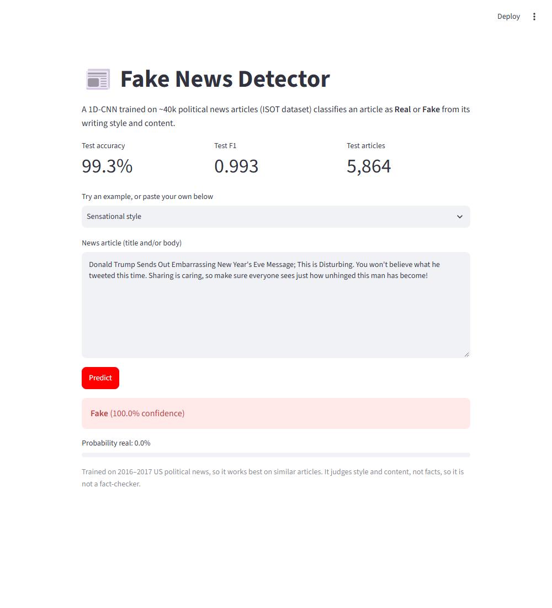
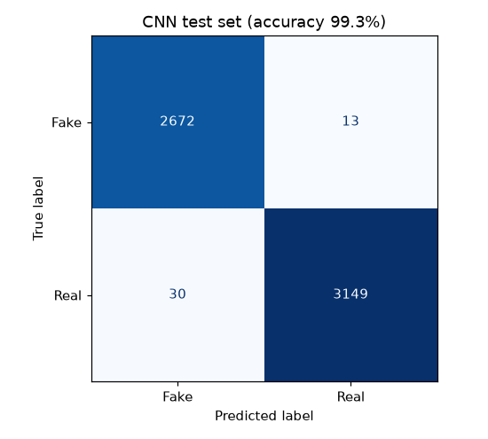

# Fake News Detector

A **1D convolutional neural network** that classifies political news articles as **Real** or
**Fake**. It's trained on ~39k unique articles from the ISOT dataset and served through a Streamlit web app.



## Results

| Model | Test accuracy |
|---|---|
| TF-IDF + Logistic Regression (raw text) | 99.0% |
| TF-IDF + Logistic Regression (source giveaways removed) | 98.3% |
| **1D-CNN (source giveaways removed)** | **99.3%** (F1 0.993) |

Results are on a stratified, held-out test set of 5,864 articles (70/15/15 train/val/test split, duplicates removed first).



### Checking the model isn't cheating

This dataset has a well-known shortcut. **99.8% of the real articles mention "Reuters"**, mostly
in a `WASHINGTON (Reuters) -` dateline. Many fake ones carry tags like "21st Century Wire", Twitter
handles or "Featured image via…". A model can reach ~99% just by spotting those words.

[`preprocess.py`](preprocess.py) strips these source markers before training **and** before
prediction. The CNN still reaches 99.3% after this, so it is picking up real differences in
writing style and content, not the publisher's name.

## How it works

```
title + text ─► strip source markers ─► TextVectorization (20k vocab, 400 tokens)
            ─► Embedding(100) ─► Conv1D(128, k=5) ─► GlobalMaxPool ─► Dropout(0.5)
            ─► Dense(64) ─► Dense(1, sigmoid) ─► P(real)
```

The tokenizer is a `TextVectorization` layer **inside** the saved model, so the app passes raw
text straight to `model.predict`. There's no separate tokenizer file that could get out of sync with the model.
Training uses early stopping on the validation set.

## Run it locally

Requires **Python 3.10–3.12**.

```bash
git clone https://github.com/karnasanjana/Fake_news.git
cd Fake_news
python -m venv .venv
.venv\Scripts\activate            # macOS/Linux: source .venv/bin/activate
pip install -r requirements.txt

streamlit run app.py              # uses the trained model in model/
```

### Retrain

1. Download the [Fake and Real News dataset](https://www.kaggle.com/datasets/clmentbisaillon/fake-and-real-news-dataset) from Kaggle.
2. Put `Fake.csv` and `True.csv` in `data/`.
3. Run `python train.py`. It prints the baseline comparison and saves `model/fake_news_cnn.keras`, `model/metrics.json` and `docs/confusion_matrix.png`.

## Project structure

```
├── app.py              # Streamlit UI
├── train.py            # data loading, baselines, CNN training & evaluation
├── preprocess.py       # removes source markers (shared by training and app)
├── fake_news.ipynb     # exploratory analysis: class balance, duplicates, text cleaning
├── model/              # trained CNN (tokenizer included) + metrics.json
└── docs/               # screenshots, confusion matrix
```

## Tech stack

Python · TensorFlow/Keras · scikit-learn · pandas · Streamlit

## Limitations

- The training data is 2016–2017 US political news. Fake articles come from flagged sites and real ones from Reuters, so the model learns *"reads like a Reuters wire story"* vs *"reads like a hyper-partisan blog"*. It will be less reliable on other topics, eras or outlets.
- It judges style and content, **not facts**. It is not a fact-checker.
